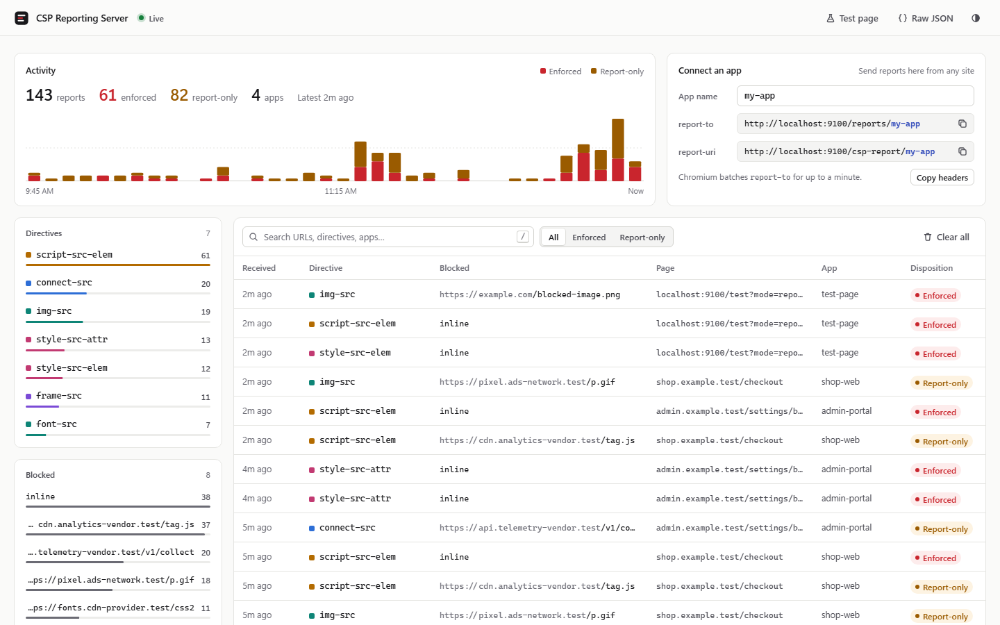
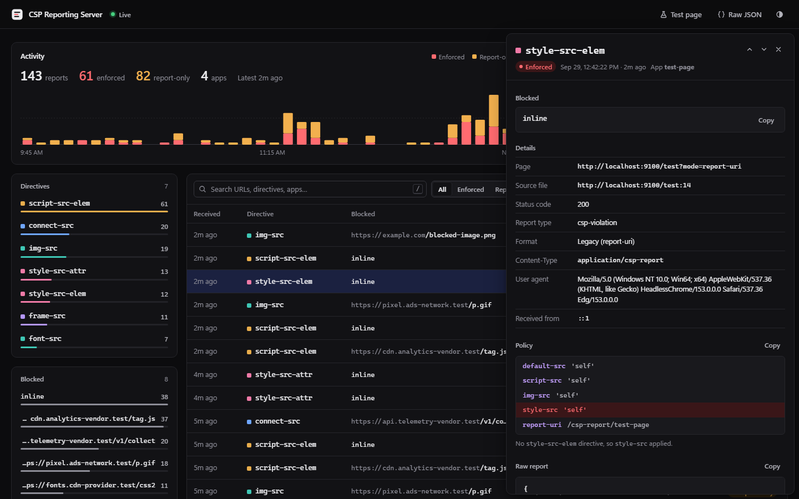
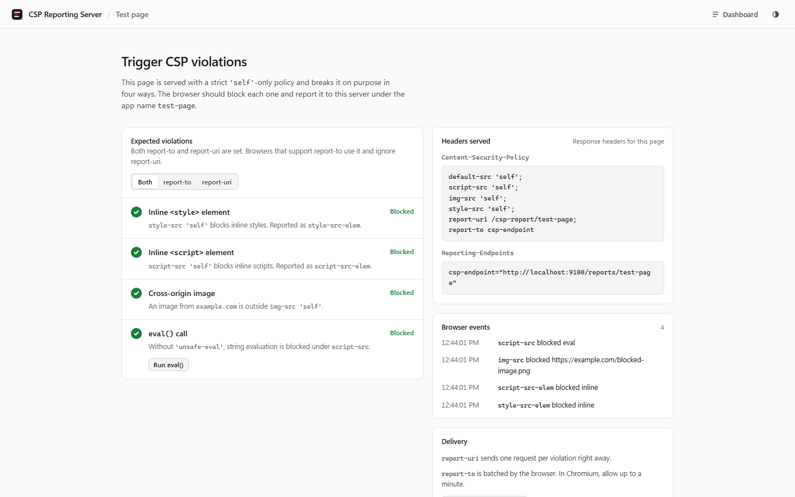

# CSP Reporting Server

> **Why this exists:** This project was created to monitor CSP blocks in [Power Apps code apps](https://learn.microsoft.com/power-apps/developer/code-apps/how-to/content-security-policy). An administrator can configure a [reporting endpoint](https://learn.microsoft.com/power-apps/developer/code-apps/how-to/content-security-policy#report-csp-violations) for code apps' Content Security Policy, and the browser sends a report every time the policy blocks something (or would block it, in report-only mode). This server is that endpoint. Set the reporting endpoint to `https://<your-host>/reports/<app-name>`, then watch what the policy blocks and tighten it with confidence. Both endpoint paths accept either report format. It works just as well for any other web app.

A small, dependency-free Node.js server that collects [Reporting API](https://developer.mozilla.org/en-US/docs/Web/API/Reporting_API) reports, with a focus on Content Security Policy (CSP) violations. Point your apps at it, then triage what your policy blocks in a live dashboard.



<sub>Screenshots use synthetic demo data (`*.example.test` hosts).</sub>

## Features

- **Both report formats.** Accepts the modern Reporting API (`report-to`, `application/reports+json`) and legacy `report-uri` (`application/csp-report`), and normalizes them into one shape. Other Reporting API types (`deprecation`, `intervention`, `coep`, and so on) are stored too.
- **Triage dashboard.** Break reports down by directive, blocked URL, and app, then filter with one click. You can also search (`/`) and filter by disposition. Filters live in the URL, so any view can be shared.
- **Report inspector.** Shows the full report, with the **violated directive highlighted inside the exact policy** (including fallbacks such as `script-src-elem` → `script-src` → `default-src`) next to the raw JSON.
- **Live updates** over Server-Sent Events, with an activity chart of enforced and report-only violations over time.
- **"Connect an app" helper.** Generates ready-to-paste endpoint URLs and headers for each app name.
- **Built-in test page** that deliberately triggers four violations and shows each one being blocked.
- **Light, dark, and system themes.** The dashboard runs under its own strict `'self'`-only CSP.
- **Zero runtime dependencies.** Reports persist to an NDJSON file.

| Report inspector (dark) | Test page |
|---|---|
|  |  |

## Quick start

Requires Node.js 22+.

```sh
npm install        # dev tooling only (ESLint); the server has no runtime dependencies
npm start          # http://localhost:9000
```

- Dashboard: <http://localhost:9000/>
- Test page: <http://localhost:9000/test> (use `?mode=report-to`, `?mode=report-uri`, or `?mode=both`)

> ⚠️ The server has **no built-in authentication**. Don't expose it to the internet without an authenticating proxy. See [SECURITY.md](SECURITY.md).

## Pointing your application at the server

| Mechanism | CSP directive | Content-Type | Endpoint |
|---|---|---|---|
| Reporting API (modern) | `report-to <name>` + `Reporting-Endpoints` header | `application/reports+json` | `/reports/<app-name>` |
| Legacy | `report-uri <url>` | `application/csp-report` | `/csp-report/<app-name>` |

`<app-name>` is optional and tells apps apart. The dashboard's **Connect an app** panel generates these values for you. For example:

```http
Reporting-Endpoints: csp-endpoint="https://reports.example.com/reports/my-app"
Content-Security-Policy-Report-Only: default-src 'self'; report-to csp-endpoint; report-uri https://reports.example.com/csp-report/my-app
```

Use `Content-Security-Policy` instead of `-Report-Only` to enforce. Reports are sent cross-origin, so the server answers CORS preflight (`OPTIONS`) requests and reflects the request `Origin`.

### Browser behavior to know

- **Chromium only delivers `report-to` reports to HTTPS endpoints from HTTPS pages** with a trusted certificate. `report-uri` works from `http://localhost`. To test `report-to` locally, run over HTTPS (below).
- Chromium **batches** `report-to` deliveries, so reports can take up to a minute to arrive. Launch the browser with `--short-reporting-delay` to speed this up.
- When a policy has both, browsers that support `report-to` ignore `report-uri`. Firefox uses `report-uri`.

### Local HTTPS

```sh
# Option A (recommended, trusted by your browser): https://github.com/FiloSottile/mkcert
mkcert -install
mkdir certs && mkcert -cert-file certs/localhost.pem -key-file certs/localhost-key.pem localhost 127.0.0.1 ::1

# Option B: self-signed via OpenSSL (you must trust it yourself)
mkdir certs && openssl req -x509 -newkey rsa:2048 -nodes -days 365 -subj "/CN=localhost" \
  -addext "subjectAltName=DNS:localhost,IP:127.0.0.1,IP:::1" \
  -keyout certs/localhost-key.pem -out certs/localhost.pem

npm run start:https   # https://localhost:9443
```

`certs/` is git-ignored. Never commit private keys.

## API

| Method | Path | Description |
|---|---|---|
| `POST` | `/reports[/<app>]`, `/csp-report[/<app>]` | Ingest reports (returns `204`) |
| `GET` | `/api/reports?type=&source=` | List stored reports (optional filters) |
| `DELETE` | `/api/reports` | Clear all reports |
| `GET` | `/api/stream` | Server-Sent Events stream (`report`, `cleared`) |
| `GET` | `/health` | Health check |

Example:

```sh
curl -X POST http://localhost:9000/reports/my-app -H "Content-Type: application/reports+json" \
  -d '[{"type":"csp-violation","url":"https://app.example/","body":{"effectiveDirective":"img-src","blockedURL":"https://evil.example/x.png","disposition":"enforce"}}]'
```

## Configuration

| Variable | Default | Description |
|---|---|---|
| `PORT` | `9000` (`9443` with `--https`) | Listen port |
| `HOST` | all interfaces (IPv4 + IPv6) | Bind address |
| `TLS_CERT` / `TLS_KEY` | `certs/localhost*.pem` with `--https` | PEM certificate and key paths (these enable HTTPS) |
| `DATA_DIR` | `./data` | Where `reports.ndjson` is stored |
| `MAX_REPORTS` | `5000` | Reports kept in memory (the file keeps everything) |
| `MAX_BODY_BYTES` | `1048576` | Maximum request body size |

## Deploy to Azure (optional)

`infra/` contains Bicep for **Azure App Service (Linux, Node 22, F1 Free tier)** plus Log Analytics and Application Insights. **App Service Authentication (Microsoft Entra ID)** protects the dashboard, `/api/*`, and `/test`. `/reports`, `/csp-report`, and `/health` stay anonymous so browsers can deliver reports. Reports persist to `/home/data`.

1. **Choose a globally unique `environmentName`** (3–40 characters). The web app becomes `app-<environmentName>.azurewebsites.net`, and the other resources are `rg-`, `asp-`, `log-`, and `appi-<environmentName>`. Edit `infra/main.parameters.json`, or pass `environmentName=...` on the command line.
2. **Create the Entra app registration** used for sign-in (single-tenant, ID tokens, no client secret):

   ```sh
   APP_ID=$(az ad app create --display-name <environmentName> --sign-in-audience AzureADMyOrg \
     --enable-id-token-issuance true --query appId -o tsv)
   az ad sp create --id $APP_ID
   ```

3. **Deploy the infrastructure:**

   ```sh
   az deployment sub create --name <environmentName> --location centralus \
     --template-file infra/main.bicep --parameters @infra/main.parameters.json authClientId=$APP_ID
   ```

4. **Register the sign-in redirect URI** using the `webAppDefaultHostName` output:

   ```sh
   az ad app update --id $APP_ID --web-redirect-uris "https://<webAppDefaultHostName>/.auth/login/aad/callback"
   ```

5. **Deploy the code.** Zip only `server.js`, `package.json`, `package-lock.json`, and `public/` (use `/` path separators), then run:

   ```sh
   az webapp deploy -g rg-<environmentName> -n app-<environmentName> --src-path app.zip --type zip
   ```

Azure terminates TLS, and the app honors `X-Forwarded-Proto`, so the test page's `report-to` URL stays `https://`. F1 has no Always On, so the first report after roughly 20 idle minutes hits a cold start. Use B1 or higher if you can't lose any legacy `report-uri` reports.

Tip: keep your own values in `infra/main.parameters.local.json`, which is git-ignored.

## Development

```sh
npm run lint
npm test
```

CI (`.github/workflows/ci.yml`) runs lint, tests, and a Bicep build on every push and pull request. Design context lives in [PRODUCT.md](PRODUCT.md) and [DESIGN.md](DESIGN.md).

## License

[MIT](LICENSE) © 2026 Russ Rimmerman
